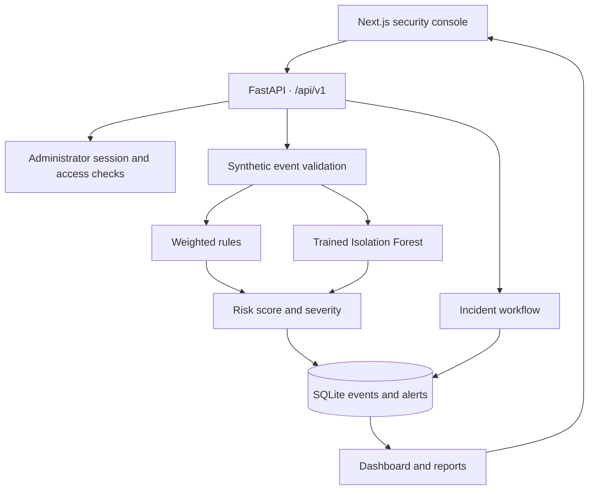

# Architecture

The browser sends application requests through the Next.js proxy. The API checks the periodic polling requests and all writes against the authenticated session. Event ingestion validates synthetic telemetry, calls both detectors, and records the event and any alert together. Dashboard reads query the persisted records. Investigation actions append actor and timestamp information to history.

Python model training runs separately from the serving process. At inference time, the service reads the serialized model from its local data directory. See [model evaluation](ML_EVALUATION.md) for training and test details.
